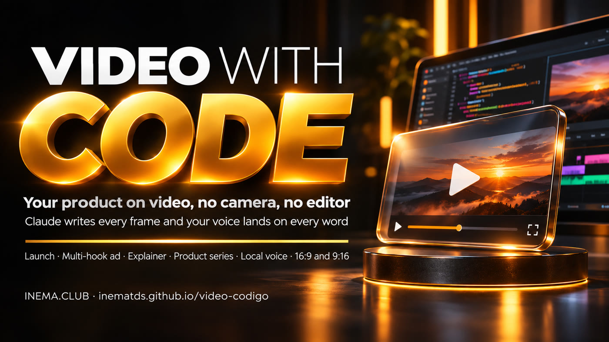

# 🎬 video-codigo — videos made with code

[](https://inematds.github.io/video-codigo/guia/en/)

**🇧🇷 [Português](README.md) · 🇺🇸 [English](README.en.md) · 🇪🇸 [Español](README.es.md)**

## What it is

video-codigo is a skill for Claude Code (and Codex) that makes videos without a camera or editing software: each frame is written in code (HTML, Canvas, or SVG) and turned into an MP4. It’s for anyone who wants to present a product, project, or idea in a video—a launch, ad, explainer, product series, or lesson. For narrated videos, the voice is generated on your computer (with no voice-generation fees), and each image appears at the moment its corresponding word is spoken. Requires Node, Python, FFmpeg, and, for voice, inemavox with an NVIDIA GPU (without one, the video has music only).

## 📖 User guide

Complete guide (landing page + walkthrough + examples): **https://inematds.github.io/video-codigo/guia/en/**

## What it does

- **Three questions before getting started:** what it’s about and who it’s for; voice or music only; and the style.
- **Reads the source:** a document, folder, repository, or website—“read everything and propose a video.”
- **Locally generated, synced voice:** `scripts/voz.py` generates narration with a cloned voice (Chatterbox) and measures the timing of each word (Whisper); the `assets/voz-sync/` engine syncs each image to a word (`pal('frase', 'palavra')`).
- **Synthesized original music:** `scripts/mezcla.py` (120 or 84 BPM), mixed very quietly under the voice.
- **16:9 and 9:16 from the same project:** the layout recalculates for each format.
- **Preview before the full render** and MP4 review with frame sheets (`scripts/inspect-video.py`).
- **INEMA theme ready to use:** `assets/inema/` (colors, local fonts, outlined captions).

## The process, from start to finish

Who does what: 🧠 session with you · ⚙️ script · 🤖 agent (Claude Code following `SKILL.md`). In the commands, `P` is the video folder (e.g., `~/videos/work/2026-11-06-myapp`), and `scripts/` is the kit’s folder (run commands from `~/projetos/video-codigo` or use the full path).

| # | Step | Command / action | Who |
|---|---|---|---|
| 1 | Request the video | "/video-codigo make a 40-second video of my product; read folder X" | 🧠 |
| 2 | Answer the 3 questions | topic and audience · voice or music only · style (INEMA default or reference) | 🧠 |
| 3 | Read the source and propose a direction | brief, shot script, duration, and formats | 🤖 |
| 4 | Approve the proposal (if you want to) | the agent shows the proposal; an explicit request to produce it counts as approval | 🧠 |
| 5 | Script → voice with word-level timing | `python3 scripts/voz.py --projeto P P/roteiro.json` → `voz.wav`, `tiempos.js` | ⚙️ |
| 6 | Music and mixing | `python3 scripts/mezcla.py --projeto P --id <id> --musica tranquila --lufs -14` | ⚙️ |
| 7 | Write the scenes | start from `exemplos/explicativo-narrado/` (voice) or `exemplos/lancamento/` (music only), then replace the scenes | 🤖 |
| 8 | Preview: individual frames and a clip | `node scripts/render-video.mjs --project P --output prova.png --still 3` (and `--start/--end`) | ⚙️ + 🤖 |
| 9 | Render in 16:9 and 9:16 | `node scripts/render-video.mjs --project P --output P/renders/x.mp4 --audio P/audio/<id>/mezcla.wav` (+ `--width 1080 --height 1920`) | ⚙️ |
| 10 | Review | `python3 scripts/inspect-video.py P/renders/x.mp4 --output-dir P/reviews` and inspect the frame sheets | ⚙️ + 🤖 |
| 11 | Deliver | MP4 + cover + editable project; publish only with your OK | 🧠 |

## Installation

```bash
git clone https://github.com/inematds/video-codigo ~/projetos/video-codigo
bash ~/projetos/video-codigo/instalar.sh     # connects the skill to Claude Code/Codex and installs Playwright (without sudo)
```

Prerequisites: Node 18+, Python 3 with `numpy`, `scipy`, and Pillow, and FFmpeg. (Ubuntu/Debian: `sudo apt install python3-numpy python3-scipy python3-pil`.) `instalar.sh` installs Playwright and Chromium (without sudo); it checks for the rest and shows the command to install it. **Voice (optional):** [inemavox](https://github.com/inematds/inemavox) in `~/projetos/inemavox`, with the Chatterbox environment (`~/miniconda3/envs/chatterbox`) and its Whisper `venv`; the reference voice is a 10–20-second `.wav` file (`"voz": "/caminho/minha-voz.wav"` in the script). Without voice, the skill works with music only.

```bash
# local voice (tested: Python 3.11, chatterbox-tts 0.1.6, NVIDIA GPU, Miniconda; models download several GB on first use)
# conda or inemavox elsewhere: CHATTERBOX_PYTHON=/caminho/python3  INEMAVOX_DIR=/caminho/inemavox
git clone https://github.com/inematds/inemavox ~/projetos/inemavox
conda create -n chatterbox python=3.11 -y
~/miniconda3/envs/chatterbox/bin/pip install chatterbox-tts==0.1.6
cd ~/projetos/inemavox && python3 -m venv venv && venv/bin/pip install faster-whisper soundfile numpy
```

Quick installation test (no voice, ~1 min):
`cd ~/projetos/video-codigo/exemplos/lancamento && node ../../scripts/render-video.mjs --project . --output teste.mp4 --audio audio/lancamento/mezcla.wav --overwrite`

## Examples (made with the kit itself)

| Example | Type | Files |
|---|---|---|
| This video has no camera | narrated explainer (local voice), 44 s | `exemplos/explicativo-narrado/` · `renders/explicativo-16x9.mp4` · `renders/explicativo-9x16.mp4` · [YouTube](https://www.youtube.com/watch?v=tkT2I6nrMAk) |
| INEMA.CLUB in one shot | launch video with music only, 21 s | `exemplos/lancamento/` · `renders/lancamento-16x9.mp4` · `renders/lancamento-9x16.mp4` · [YouTube](https://www.youtube.com/watch?v=IJ-qZQ1drBc) |

The narrated example script uses the `nei` voice, which is only available on the author’s machine. To generate the voice again, run it with `VC_VOZ=/caminho/sua-voz.wav`. To recreate only the video (the audio is already in the repository): `cd exemplos/lancamento && node ../../scripts/render-video.mjs --project . --output x.mp4 --audio audio/lancamento/mezcla.wav`.

## Structure

```
SKILL.md              skill instructions (the agent follows these)
references/           brief, direction, motion, sound, voice, rendering, review, film prompts
scripts/              voz.py (local voice) · mezcla.py · render-video.mjs · render-tramos.sh · inspect-video.py · …
assets/inema/         INEMA theme + local fonts
assets/voz-sync/      timing engine (image synced to word)
exemplos/ renders/    two complete videos and the MP4 files
guia/                 guide page (PT/EN/ES)
```

---
[INEMA.CLUB](https://inema.club)